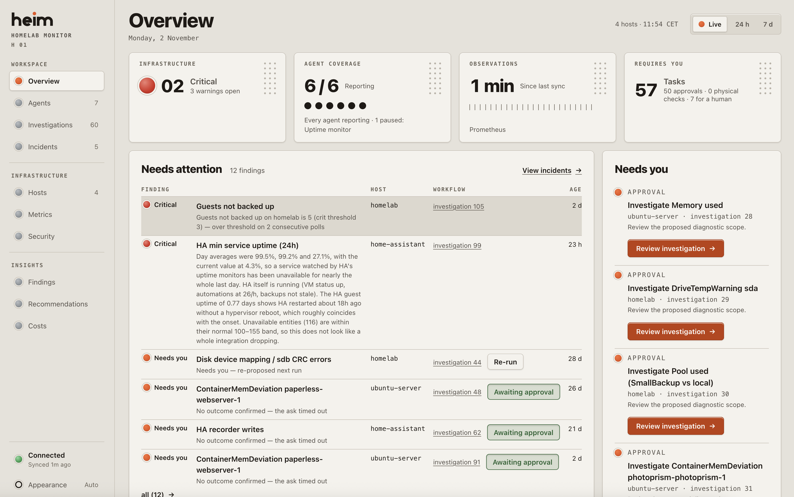
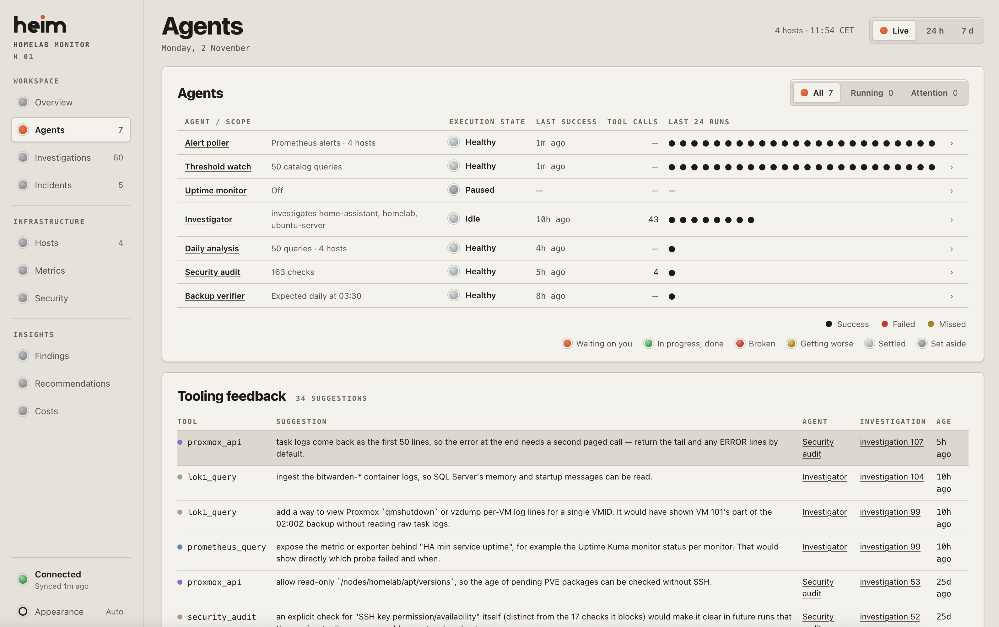
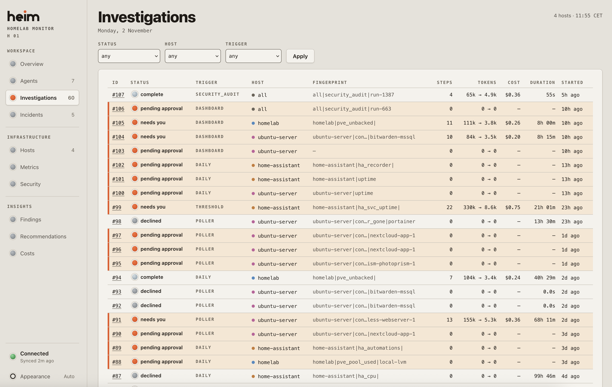
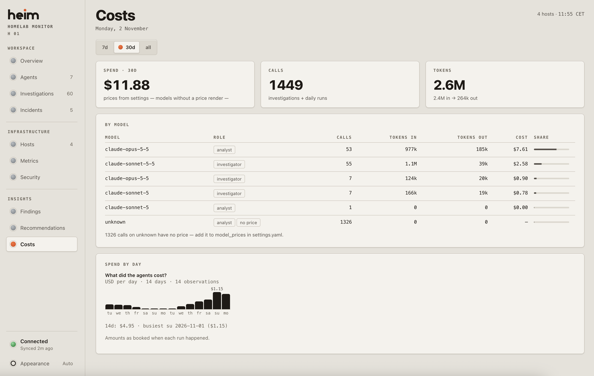

# HEIM — Homelab Event & Incident Monitor

HEIM (German: *home*) watches a homelab, opens incidents when something goes wrong, and
lets an AI agent find the root cause, with a human approving each investigation.

HEIM is a **proof of concept** for agentic monitoring of a homelab. The idea it tests:
small agents built for one job, with tools and prompts made for this homelab, give
better answers than a generic chatbot pointed at a server. It is not a monitoring
stack of its own. It reads from, and depends on, the usual third-party tools.

## What it depends on

Required:

- **Prometheus**: the metrics every agent reads and the alert rules the poller turns
  into incidents. Its sources are node_exporter (hosts), cAdvisor (containers) and the
  Proxmox VE exporter (guests and the hypervisor).
- **An LLM provider**: Anthropic runs the investigator, the security auditor and the
  daily analyst's fallback (`ANTHROPIC_API_KEY`).

Optional (each one adds a capability, and HEIM runs without it):

- **OpenRouter**: the daily analyst's fallback model (DeepSeek Flash), tried when
  Anthropic fails. Without it an Anthropic outage means no daily report, and an email
  saying so.
- **Loki**: logs the investigator can query (the systemd journal and container logs),
  and HEIM's own event stream.
- **Uptime Kuma**: service outages, read from its `/metrics`.
- **Proxmox VE API**: read-only access for the agents (auditor-role token).
- **Home Assistant API**: read-only access for the agents, and report sensors.
- **Read-only SSH**: a dedicated user with a scoped sudoers list on the hosts that have
  a shell.
- **Telegram**: approvals, notifications and a live feed of the agent's tool calls.
  Without it you approve from the dashboard.
- **SMTP**: email reports. Without it reports are written to `out/`.
- **Grafana**: extra dashboards over Prometheus and Loki (`grafana/`).

## Screenshots









## The agents

HEIM runs seven agents. Each one has a single job, and the dashboard's Agents page shows
whether each one is reporting.

- **Alert poller**: every 5 minutes, reads the firing Prometheus alerts and opens,
  escalates or resolves incidents.
- **Threshold watch**: in the same poll, checks every metric in the query catalog
  against its own warning and critical bounds. A series must stay over its bound for two
  polls in a row before an incident opens.
- **Uptime monitor**: in the same poll, reads Uptime Kuma. A monitor that is down opens
  an incident and sends one Telegram message per host.
- **Daily analysis**: twice a day, runs 50 PromQL queries over three days and asks an
  LLM for degradation trends. The result is an HTML email, a Home Assistant sensor and a
  set of findings.
- **Investigator**: finds the root cause of one incident (below).
- **Security audit**: weekly, runs 47 fixed, read-only configuration checks. A model
  then explains and ranks the results. It never decides what is a finding.
- **Backup verifier**: nightly, snapshots HEIM's own database and prunes old history.

### From signal to incident

The poller, threshold watch, uptime monitor and daily analysis all write to one incident
store. An incident's identity is a stable fingerprint, `host|qid|name`, built from the
metric, never from the model's wording. The same problem seen twice is one incident,
and each path resolves only the incidents it opened.

### How an investigation happens

1. A new or escalated incident on a host HEIM can investigate proposes an
   investigation. You can also start one from the dashboard or the CLI.
2. The investigator asks for approval, over Telegram buttons or on the dashboard. It
   waits until you answer, across restarts.
3. Once approved, the agent calls read-only tools: SSH commands, PromQL queries, metric
   discovery, LogQL, the Home Assistant API and the Proxmox API. Every call passes a
   guard first, and the OS or API permissions are read-only as well. Each call is
   written to a local audit log and, with Telegram set up, streamed to the chat.
4. The agent writes a report that starts with `## Summary`: findings, root cause with a
   confidence level, and proposed actions.

### The human in the loop

The agents never change anything. You decide:

- **Approve or decline** each investigation. A declined one is proposed again later.
- **Confirm the outcome** on Telegram: resolved, or needs a human.
- **Judge findings**: confirmed, or false positive. A false positive mutes its
  fingerprint for 90 days by default.
- **Mute or unmute** an incident directly.
- **Done or Dismiss** each recommendation.

Verdicts, mutes and recommendation marks can all be taken back from the dashboard.

### The result

A root-cause report with a confidence level and proposed actions, delivered by email,
by Telegram, as a Home Assistant sensor, and on the dashboard. The dashboard sorts the
report into observations (the tool calls), interpretation, proposed actions and the
actions you took.

### Feedback about the tools

An investigator report may end with an optional `## Tooling feedback` section: up to
three `tool_name: suggestion` lines on what would have made this investigation faster
or more certain. HEIM indexes these per tool. The latest suggestion for each tool shows
on the overview's tool-usage card, next to how often that tool was called. Each agent's
page lists its last 50 tool calls. The security auditor writes the same kind of review
in `## Audit feedback`, shown on the Security page. These are proposals only. Nothing
changes automatically.

## Install

With Docker (recommended). HEIM needs no inbound port except the optional dashboard.

```bash
git clone <this repo> && cd heim
cp .env.example .env && $EDITOR .env        # your IPs, ids and secrets
echo "HEIM_SSH_KEY_FILE=$HOME/.ssh/pam_agent" >> .env   # the agent's SSH key, if any
# edit config/hosts/*.yaml, or delete the hosts you don't have

docker compose run --rm heim check            # validates config and connectivity
docker compose run --rm heim daily --dry-run  # a full run; the report lands in ./data/out/
docker compose up -d --build                  # the daemon and the dashboard (:8300)
```

Keep the dashboard on your LAN and set `HEIM_DASHBOARD_TOKEN` in `.env` to require a
password.

Without Docker: `python3 -m venv .venv && .venv/bin/pip install -e .`, then
`.venv/bin/heim check` and `.venv/bin/heim daemon`. See [docs/INSTALL.md](docs/INSTALL.md)
for the full setup, the read-only SSH user, API tokens, systemd, and Uptime Kuma.

To let your Prometheus watch HEIM itself, scrape the dashboard's `/telemetry`:

```yaml
- job_name: 'heim'
  metrics_path: /telemetry
  static_configs:
    - targets: ['<heim-host>:8300']
```

## Documentation

- [docs/INSTALL.md](docs/INSTALL.md): full setup, permissions, systemd, observability stack.
- [docs/CONFIGURATION.md](docs/CONFIGURATION.md): `.env`, settings, hosts, tools, agents, queries.
- [docs/AGENTS-AND-TOOLS.md](docs/AGENTS-AND-TOOLS.md): agents, tools, guards, approvals, feedback.
- [docs/DASHBOARD.md](docs/DASHBOARD.md): pages, actions, colour code.
- [docs/OPERATIONS.md](docs/OPERATIONS.md): CLI, backups, retention, replay, costs.
- [docs/ARCHITECTURE.md](docs/ARCHITECTURE.md): data flow, module map, n8n heritage.
- [AGENTS.md](AGENTS.md): conventions and invariants for anyone working on the code.
