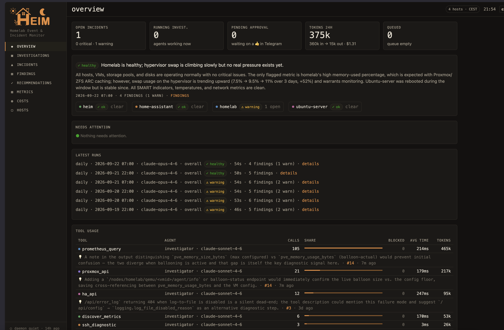

# HEIM — Homelab Event & Incident Monitor

**HEIM** (German: *home*) is a standalone Python port of the n8n **Prometheus Agentic Monitor** stack: a daily AI-written
health report over your Prometheus metrics, plus an **approval-gated agentic investigator**
that SSHes into the affected host (read-only, guarded), queries Prometheus/Home Assistant/
Proxmox live, and delivers a confidence-rated root-cause report — by email, Telegram, Home
Assistant sensors, and a Loki event stream that feeds the existing Grafana dashboard.

Everything the n8n version encoded in workflow JSON is now **declarative config + tested
code**: hosts, tools, agents, prompts, and the PromQL catalog are one file each, so
extending the system means adding a file — not editing a Code node inside an export.

```
┌────────────┐   cron 07:00/22:00   ┌─────────────────────────────────────────┐
│            ├─────────────────────►│ daily: 49 PromQL ranges → aggregate →   │──► email
│   daemon   │                      │ LLM trend analysis → reconcile incidents│──► HA sensor
│ (or cron / │   every 5 min        └───────────────┬─────────────────────────┘──► Loki
│  CLI runs) ├─────────────────────►┌───────────────┴─────────────────────────┐
│            │                      │ poll: /api/v1/alerts → diff → upsert,   │──► Telegram
└────────────┘                      │ + metric thresholds → hysteresis → open │
                                    └───────────────┬─────────────────────────┘
                                         new / escalated incidents
                                                    ▼
                                    ┌─────────────────────────────────────────┐
                                    │ investigation: Telegram approval →      │
                                    │ agent loop (Claude + 5 guarded tools) → │──► email/TG/HA/Loki
                                    │ salvage/render → outcome confirm        │
                                    └─────────────────────────────────────────┘
```

---

## Project structure

```
heim/
├── pyproject.toml                  # package + deps; installs the `heim` CLI
├── .env.example                    # secrets template (API keys, tokens) → copy to .env
├── config/                         # ← ALL declarative configuration
│   ├── settings.example.yaml       #   endpoints, schedules, recipients → copy to settings.yaml
│   ├── settings.yaml               #   your deployment values (gitignored)
│   ├── hosts/                      #   ← one file per monitored host
│   │   ├── ubuntu-server.yaml      #     role: guest · ssh access · prompt facts · privileges
│   │   ├── homelab.yaml            #     role: hypervisor · Proxmox API · investigable categories
│   │   └── home-assistant.yaml     #     role: ha-guest · HA API
│   ├── tools/                      #   ← one file per agent tool (LLM description + arg schema)
│   │   ├── ssh_diagnostic.yaml     #     guarded read-only shell on an SSH host
│   │   ├── prometheus_query.yaml   #     instant + range PromQL, token-compact results
│   │   ├── discover_metrics.yaml   #     metric-name/label-set discovery
│   │   ├── loki_query.yaml         #     read-only LogQL: journal (homelab, ubuntu-server, HA OS) + docker logs
│   │   ├── ha_api.yaml             #     GET-allowlisted Home Assistant REST
│   │   └── proxmox_api.yaml        #     GET-allowlisted Proxmox VE API
│   ├── agents/
│   │   ├── investigator.yaml       #   model, step budget, tool list, prompt template
│   │   └── daily_analyst.yaml      #   primary model (OpenRouter) + fallback (Anthropic)
│   ├── prompts/                    #   ← jinja2 prompt templates
│   │   ├── analyst.md              #     daily analyst system prompt (strict-JSON contract)
│   │   ├── investigator.md.j2      #     investigator system prompt; facts/privileges injected
│   │   └── briefs/                 #     per-host-role investigation briefs
│   │       ├── guest.md.j2  ·  hypervisor.md.j2  ·  ha-guest.md.j2
│   │       ├── _report_spec.md  ·  _temperature_playbook.md.j2
│   └── queries/daily.yaml          #   the 49-query PromQL catalog (qid, thresholds, category)
├── src/heim/
│   ├── config.py                   # pydantic models + loader for everything under config/
│   ├── runtime.py                  # wiring: store + channels + dry-run behavior
│   ├── llm.py                      # analyst completion (OpenRouter primary → Anthropic fallback)
│   ├── cli.py                      # `heim check|daily|poll|investigate|incidents|replay|daemon`
│   ├── daemon.py                   # APScheduler cron/interval jobs
│   ├── agent/
│   │   ├── runner.py               #   the Anthropic tool-use loop (budget, retries, real tokens)
│   │   └── cassette.py             #   recorded tool results from a stored transcript (replay)
│   ├── tools/                      # tool framework + one module per tool
│   │   ├── base.py                 #   Tool base class, ToolContext (feed/audit), registry
│   │   └── ssh_diagnostic.py · prometheus_query.py · discover_metrics.py · loki_query.py · ha_api.py · proxmox_api.py
│   ├── guards/                     # safety guards (ported from n8n, 119 tests)
│   │   ├── command_guard.py        #   segment-aware read-only shell-command gate
│   │   ├── ha_guard.py · proxmox_guard.py   # GET path allowlists
│   ├── incidents/
│   │   ├── types.py                #   HostRouting, ReconcileResult, Poller/ThresholdDecision
│   │   ├── store.py                #   SQLite incident store (was the n8n Data Table)
│   │   ├── reconcile.py            #   pure incident reconciler (fingerprints, hysteresis, locks)
│   │   ├── poller_logic.py         #   pure alert-poller diff
│   │   ├── state.py                #   dashboard state snapshot (healthScore, risk)
│   │   └── loki_events.py          #   finding/category/incident event builders
│   ├── metrics/
│   │   ├── queries.py              #   query catalog loader + 3-day window
│   │   ├── aggregate.py            #   fold query_range results into the analyst payload
│   │   ├── promql.py               #   agent-tool range params + token-compact encoding
│   │   ├── discover.py             #   metric-catalog filtering
│   │   └── proxmox_format.py       #   Proxmox response compaction (tasks lists)
│   ├── channels/
│   │   ├── telegram.py             #   notify, live feed, chunked reports, INLINE-BUTTON approvals
│   │   ├── email.py                #   SMTP HTML delivery
│   │   ├── ha.py                   #   sensor.pam_* pushes
│   │   └── loki.py                 #   batched event push (same schema as the n8n stack)
│   ├── reports/
│   │   ├── render.py               #   salvage logic + markdown→styled-HTML emails
│   │   └── templates/              #   investigation.html.j2 · daily.html.j2
│   └── pipelines/
│       ├── daily.py                #   the daily run (was n8n PAM 10)
│       ├── poller.py               #   the fast-path poll cycle (was PAM 11) + thresholds
│       ├── thresholds.py           #   incidents from the catalog's own warn/crit bounds
│       ├── investigate.py          #   the approval-gated investigation (was PAM 20)
│       └── replay.py               #   offline replay of a stored investigation (eval harness)
├── Dockerfile · docker-compose.yml # container deployment (recommended) — see below
├── src/heim/dashboard/             # the built-in web UI (FastAPI + htmx; reads + actions)
├── grafana/                        # the "Homelab AI Operations" dashboard + Loki datasource
│   ├── dashboards/homelab-ai-operations.json · loki-alerts-findings.json
│   └── provisioning/datasources/loki.yml
├── tests/                          # 1029 tests, incl. faithful-port golden cases
└── docs/ARCHITECTURE.md            # design, data flow, n8n→module provenance map
```

---

## Quick start

```bash
git clone <this repo> && cd heim
python3 -m venv .venv && .venv/bin/pip install -e ".[dev]"

cp .env.example .env                              # fill in secrets (at least ANTHROPIC_API_KEY)
cp config/settings.example.yaml config/settings.yaml   # set your endpoints / chat id / email
# edit config/hosts/*.yaml — SSH user/key, API endpoints, or delete hosts you don't have

.venv/bin/heim check                               # validates config + connectivity, per item
```

Then try it — every command supports `--dry-run` (emails become HTML files under `out/`,
Telegram/Loki/HA sends become log lines, approvals auto-granted):

```bash
heim daily --dry-run                # full daily run: metrics → LLM → report in out/*.html
heim poll --dry-run                 # one poll cycle: firing alerts + metric thresholds
heim thresholds                     # what is over threshold right now, and its streak
heim investigate --host ubuntu-server --dry-run \
    --finding "memory used climbed 31% → 43% over 3 days, swap growing"
heim incidents                      # show the incident store
heim daemon                         # the real thing: schedules + poller + approval listener
```

### Run it in Docker (recommended)

HEIM is outbound-only (Telegram approvals long-poll — no webhook), so the container
publishes **no ports**. All mutable state (SQLite store, audit log, dry-run reports)
lives in `./data`; `config/` is mounted read-only; secrets come from `.env`.

```bash
cp .env.example .env && $EDITOR .env      # your IPs, ids and secrets live here
echo "HEIM_SSH_KEY_FILE=$HOME/.ssh/pam_agent" >> .env   # host path of the agent's SSH key
# config/settings.yaml is OPTIONAL: without it HEIM runs on settings.example.yaml,
# which is fully ${VAR}-interpolated from .env. Copy it only to change structure
# (schedules, retention, which channels are enabled):
#   cp config/settings.example.yaml config/settings.yaml

docker compose run --rm heim check          # validate config + connectivity
docker compose run --rm heim daily --dry-run   # report lands in ./data/out/
docker compose up -d --build                # the daemon
docker compose logs -f heim
```

Notes:
- One-off commands (`check`, `daily`, `poll`, `investigate`, `incidents`) run via
  `docker compose run --rm heim <cmd>` with the same mounts as the daemon.
- The image is built on the host that runs it (`--build`), so ARM Mac vs x86 server
  needs no multi-arch registry work.
- Don't run a second daemon (locally or elsewhere) against the **same Telegram bot
  token** — `getUpdates` allows one consumer; use a separate dev bot for local tests,
  or stick to `--dry-run` (which never touches Telegram).
- On Proxmox, run this in a small **VM with Docker** (Docker-inside-LXC works with
  `nesting=1` but is upgrade-fragile). A guest separate from the monitored hosts also
  means HEIM survives — and alerts on — an outage of the main server.

### The built-in dashboard (web UI)

A self-contained web UI laid out as an operator's console (a Braun-style instrument
panel, light and dark): a grouped rail with a lamp per section, and every agent shown as
one channel with its own run strip, so a watcher that stopped reporting is as visible
as a failing disk. Nothing is lit unless it needs a hand. It still centres on the
agent's investigations: each one shows what triggered it (findings + the exact brief
sent to the agent), its trigger source, agent + model, real token usage and cost, and
a terminal-style transcript of each tool call ($ command, result preview, duration,
blocked markers) with a "burn line" showing where the token budget went.



The screenshot predates the console redesign (2026-11-01) and is due a refresh;
working captures of the new design stay out of the repo.

The pages:

- **Overview** — four instrument cards (infrastructure condition, agent coverage,
  time since the last sync, what requires you), **Needs attention** (open incidents by
  severity, with what HEIM is doing about each, plus investigations that need a
  re-run), **Needs you** (approvals and physical checks), and the **Agents** panel;
  below them the health card (the latest analysis + a per-host strip), the last daily
  runs, a **tool usage** card (which tool, by which agent and model: calls, blocked,
  avg time, tokens — plus the agent's own latest note on what would make that tool
  more useful, from its report's optional `## Tooling feedback` section), token usage,
  recent investigations and findings. A top-bar **window switch** (Live / 24 h / 7 d)
  scopes the run strips; what is open stays what is open now.
- **Agents** — the seven agents (alert poller, threshold watch, uptime monitor,
  daily analysis, security audit, backup verifier, investigator) with their state
  (Healthy, Degraded, Failed, Overdue, Paused, No data yet), last success and last
  runs; a stale or failing one gets a "monitoring gap" line. Each has a detail page
  (`/agents/<key>`) with its coverage, cadence, last error, a run table and a link to
  its evidence. The heartbeats come from the daemon only (`agent_runs`); a CLI
  one-off never counts as the agent being alive.
- **Investigations** — filterable list with live-polling running rows and queued ghost
  rows; the detail page sorts the report into observations (the transcript),
  interpretation, proposed and completed actions, with the raw report kept.
- **Incidents** — the store with lifecycle, dispatch locks, and mute state.
- **Findings** — full history as a per-run table: severity lamps, color-coded host
  badges, in-row detail expanders, verdict actions; every finding links to its
  evidence (the metric row, the incident, its investigation).
- **Recommendations** — the open remediation steps from incidents and investigations,
  each linked to its source, marked done or dismissed.
- **Security** — the weekly security audit by severity: critical and warning tiles,
  one section per severity (new before persisting before carried, with how many weeks
  each has been reported), what was resolved since the previous audit (marked when it
  was muted rather than fixed), a link to the full report and AI assessment, and a
  history table that opens any past audit. Dry runs never appear. Each run also gets an
  **auditor feedback** card: the model's own review of the audit — what limited this
  run and how to fix it, and which read-only checks this week's findings make worth
  adding. Proposals only; nothing is added or changed automatically.
- **Metrics** — everything the daily email shows, live: per-host, per-category tables
  with current/avg, 3-day trend and Δ, from the same aggregation the analyst sees
  (10-minute cache, a refresh button); each chart states its question, unit, window
  and thresholds, and draws gaps where observations are missing.
- **Costs** — token and cost history per day over 7 d / 30 d / all.
- **Hosts** — per-host cards with one-click investigate.

Dense and resource-light: system fonts, one ~31 KB stylesheet, vendored htmx, no build
step, no chart library, and it works on a phone (the rail becomes a row of chips, no
sideways scrolling at 320 px). The design system — tokens, lamps, labels, components —
is locked in [`design.md`](design.md); change it there, on purpose. `/telemetry` exposes HEIM's own counters in Prometheus text
format so your existing Prometheus/Grafana can watch the watcher. Scrape it with a job
like this (this homelab's copy sits commented out in the ansible-homelab repo's
`stacks/ubuntu-server/prometheus/prometheus.yml`):

```yaml
- job_name: 'heim'
  metrics_path: /telemetry
  static_configs:
    - targets: ['<heim-host>:8300']
```

It also *acts*, through plain forms (htmx is only an enhancement): queue an
investigation from a host card or an incident, re-run one with fresh evidence,
approve or decline a pending run without Telegram, judge a finding (confirm /
false positive), and mute or unmute a fingerprint. The overview shows the queue
depth and the investigations list shows queued jobs as ghost rows.

```bash
heim dashboard                      # http://localhost:8300
docker compose up -d dashboard      # or as the optional compose service
```

The containers create `./data` on first run and take ownership of it (they start as
root only long enough to fix the bind mount's permissions, then drop to an
unprivileged user) — no manual `mkdir`/`chown` needed on a fresh host.

It opens the SQLite store over WAL and writes **action rows only** (jobs, approval
decisions, verdicts, suppressions) — the daemon stays the sole executor and the sole
writer of the pipeline tables. It is
heim's only inbound port: keep it LAN/tailnet-only, and set `HEIM_DASHBOARD_TOKEN` in
`.env` to require HTTP basic auth (any username, the token as password). Design spec:
[`docs/design/dashboard-ui.md`](docs/design/dashboard-ui.md).

### Built-in operations

- **Dead-man's switch** — set `HEIM_DEADMAN_URL` (a healthchecks.io-style ping URL) and
  the daemon pings it after every successful poll cycle; if HEIM itself dies, your
  external watchdog alerts. Daemon-only by design, so ad-hoc CLI runs can't mask a dead
  scheduler.
- **Nightly backups** — 03:30 snapshot of the SQLite store (online backup API, safe
  against the live WAL db) into `data/backups/`, keeping the newest `backup_keep` (14).
- **Retention** — resolved incidents, findings, runs, finished investigations and closed
  jobs are pruned past `retention_days` (120; jobs capped at 30). Suppressions and
  anything open or unfinished are never touched; the backup always runs first, and a
  failed backup skips the prune.

### Replay — would another model have said the same thing?

`heim replay` re-runs a **stored** investigation offline: same brief, same system
prompt, and the original run's **recorded tool results** served back to the model from
its stored transcript. Nothing is measured live — no SSH, no Prometheus/HA/Proxmox, no
approval, no email/Telegram/HA/Loki — so the only thing that changes is the model or
the prompt, which is the only way the comparison means anything (the disk that was full
in March is not full today).

```bash
heim replay 42                                   # same model: reproducibility check
heim replay 42 --model claude-haiku-4-5          # cheaper model, same evidence
heim replay 42 --prompt-file prompts/candidate.md.j2
```

**Prerequisite:** the investigation must have a stored transcript, i.e. it ran with
`store_transcripts: true` in `config/settings.yaml` (off by default — transcripts are
large). Runs recorded before you switched it on cannot be replayed; the command says so.

The output puts the two runs side by side — model, status, steps, tokens, cost — then
the cassette hit rate and both `## Root cause` sections with a unified diff:

- **exact** — the replay made the same call with the same arguments and got the
  original's bytes;
- **fuzzy** — same tool, different arguments: it got the oldest unused recording for
  that tool, which is *plausible* evidence rather than an answer to the question it
  asked, so a high fuzzy count means read the diff with more suspicion;
- **missed** — nothing recorded left for that tool, so the model is handed an explicit
  `{"replay": "no recorded result …"}` stub. A replay never invents output.

The replay is stored as a normal investigation (`trigger: replay`) linked back to its
original, so it shows up in the dashboard with its own steps, tokens, cost and
transcript — and can itself be replayed.

### Alternative: bare systemd service

```ini
# /etc/systemd/system/heim.service
[Unit]
Description=HEIM - Homelab Event & Incident Monitor
After=network-online.target

[Service]
User=heim
WorkingDirectory=/opt/heim
ExecStart=/opt/heim/.venv/bin/heim daemon
Restart=on-failure
RestartSec=30

[Install]
WantedBy=multi-user.target
```

```bash
sudo systemctl enable --now heim
journalctl -u heim -f
```

---

## Configuration reference

### Environment interpolation — deployment identity lives in `.env`

Every file under `config/` (and the prompt templates) supports `${VAR}` /
`${VAR:-default}` references, expanded from the environment at load time. All
deployment-specific identity — server/Proxmox/HA IPs, SSH user, Telegram chat id,
email recipients — therefore lives in `.env` next to the secrets:

| Variable | Used for |
|---|---|
| `HEIM_SERVER_IP` | Prometheus/Loki URLs, SSH target, instance→host mapping |
| `HEIM_PROXMOX_IP` | Proxmox API URL, PromQL examples in the prompts, mapping |
| `HEIM_HA_IP` | Home Assistant URL, mapping |
| `HEIM_SSH_USER` | the read-only SSH user (default `monitoring-agent`) |
| `HEIM_TELEGRAM_CHAT_ID` | approval/report chat |
| `HEIM_EMAIL_TO` / `HEIM_EMAIL_FROM` | report delivery |
| `HEIM_UPTIME_KUMA_URL` | Uptime Kuma base URL (`uptime_kuma.url`); empty = the source is off |
| `UPTIME_KUMA` | Uptime Kuma API key (Settings → API Keys); HEIM reads `/metrics` with HTTP basic auth, empty username |

`config/settings.yaml` can be copied from the example **unchanged**; a reference
without a default that is unset fails at startup naming the variable and file. In
Docker, `.env` is injected via compose's `env_file`, so the same mechanism works
identically in and out of the container.

### `config/settings.yaml`
Endpoints, schedules, recipients, timeouts — see the commented
[`settings.example.yaml`](config/settings.example.yaml). Every optional block
(`loki`, `telegram`, `email`, `home_assistant`) can be **removed entirely** to disable
that channel; the pipelines degrade gracefully (e.g. no email config → reports are
written to `out/`).

Four knobs are worth setting deliberately:

| Setting | Effect |
|---|---|
| `model_prices` + `currency` | model id → `{input, output}` price **per million tokens**. Ships commented out with placeholder numbers — fill in your provider's current pricing and investigations, runs and the 24h tile start showing money. A model with no entry stays *unpriced*: the UI shows an em dash, never a made-up `$0.00`. |
| `investigator_models` | exact model ids offered when *triggering* an investigation — a compact select next to every `INVESTIGATE` button and `heim investigate --model X`. Empty (the default) renders no select and every run uses the investigator agent's own model. The chosen model overrides that agent for **that run only** and is recorded on the investigation row, so costs and tool usage segment by it. List only ids you also priced in `model_prices`. |
| `threshold_detection` + `threshold_severity` + `threshold_consecutive` | open incidents from the **metric catalog's own** `warn`/`crit` bounds, not just from the Prometheus alert rules and the daily LLM's findings. Evaluated inside the existing poll cycle, so the approval gate, the concurrency cap and false-positive mutes all apply unchanged. `threshold_consecutive` is the hysteresis: a series must be over its bound on that many **consecutive** polls before an incident opens (streaks survive a daemon restart), which is what keeps a single-scrape spike from burning an agent run. These incidents are marked `[metric] ` and this path resolves only its own. |
| `store_transcripts` | keep each agent's full message history with its investigation (capped at 512 KB, oldest turns dropped) for post-morteming a wrong root cause, and the prerequisite for `heim replay` (the transcript is the cassette). Off by default — it is large. |

### `config/hosts/*.yaml` — add a host, add a file
| Field | Meaning |
|---|---|
| `role` | `guest` (fully investigable; SSH-reachable if it has an `ssh:` block) · `hypervisor` (investigated from the guest side + its own API) · `ha-guest` (API only) |
| `investigable` | `all`, or a category list (`[cpu, memory, temperature, disk, diskHealth]`) — gates which findings trigger investigations |
| `ssh` | host/port/user/key for a `role: guest` with a shell (key path overridable via `HEIM_SSH_KEY`). Omit it and the guest is monitored via Prometheus + `proxmox_api` only — the brief and the approval prompt both drop their SSH wording, so the agent does not plan around a shell it has not got. |
| `api` | base URL (+ `verify_ssl`) for hypervisor / ha-guest hosts |
| `facts` | injected verbatim into the investigator's `[FACTS]` prompt block — topology truths the agent must know |
| `privileges` | injected into `[PRIVILEGES]` — keep in sync with the host's actual sudoers/groups |

To add a second SSH host: create the YAML (`role: guest` + `ssh:`), grant the same
read-only permission set on the host (see *Security*), and add its address to
`instance_host_map` in settings. The reconciler and poller pick it up automatically.

Two things to get right when the host is a Proxmox guest:

- **Name it exactly as the PVE guest is named.** A host's identity comes from
  `instance_host_map` for `node_*` series and from the PVE guest name for `pve_*`
  series. If those disagree, one machine shows up as two hosts with two sets of
  fingerprints. `config/hosts/heim.yaml` is the worked example (guest `qemu/103`).
- **Append it to `host_color_order`.** Badge colours are handed out by position, and
  config order is alphabetical by filename, so an unpinned new host repaints every
  host that now sorts after it.

### `config/tools/*.yaml` — add a tool, add a file + a class
`name`, LLM-facing `description`, JSON-schema `args`/`required`, `options` (host binding,
clip bytes), and `module: pam.tools.mymod:MyTool`. The class implements
`async def run(self, args) -> str` — see [`src/heim/tools/base.py`](src/heim/tools/base.py).
List the tool's name in an agent's YAML and it's live.

### `config/agents/*.yaml`
The **investigator**: Anthropic model id, `soft_step_budget` (told to the model),
`hard_step_cap` (enforced by the loop — past it, tool calls are refused and the model is
told to write the report), prompt template, tool list. The **analyst**
(`kind: analyst`): primary + fallback model refs and the strict-JSON prompt.

### `config/queries/daily.yaml`
The 49-query catalog (qid, category, label, unit, direction, warn/crit thresholds,
verbatim PromQL) + the 3-day/3h window. Add or trim queries freely — `qid` is the stable
identity used in incident fingerprints and alert-rule labels, so keep qids stable and
matching the `qid` labels of the Prometheus alert rules (in the ansible-homelab repo, see
[Observability stack](#observability-stack-grafana--loki--prometheus)).

---

## Observability stack (Grafana / Loki / Prometheus)

This repo ships the Grafana dashboards (deploy notes in
[`grafana/README.md`](grafana/README.md)). Prometheus and Loki — their compose files,
`prometheus.yml`, `loki-config.yml` and the alert rules — are configured and deployed by
the **ansible-homelab** repo (`stacks/ubuntu-server/prometheus/` and `…/loki/`), which
holds the only copy:

- **`grafana/dashboards/homelab-ai-operations.json`** — the AI-operations dashboard
  (agent status, incidents, investigations, risk, infra trends & forecasts; 42 panels).
  Import it and map its two inputs (`DS_PROMETHEUS`, `DS_LOKI`). HEIM emits the exact
  event schema its LogQL queries expect (`job=homelab-ai-monitor`; `state` / `incident` /
  `finding` / `category` / `investigation` / `action`), so it works with HEIM and the n8n
  stack interchangeably — including while running both side by side.
- **`grafana/dashboards/loki-alerts-findings.json`** — a second, Loki-only view of alerts
  and LLM findings.
- **Loki** (ansible-homelab: `stacks/ubuntu-server/loki/`) — single-binary Loki with
  filesystem storage and 90-day retention.
- **Prometheus alert rules** (ansible-homelab: `stacks/ubuntu-server/prometheus/alerts.yml`)
  — the fast-path rules HEIM's poller turns into incidents. They are functionally coupled
  to HEIM, and that repo's README ("Prometheus alert rules") and `make guards` hold the
  contract:
  - every rule carries a `qid` label; where it watches the same signal as a query in
    [`config/queries/daily.yaml`](config/queries/daily.yaml) it reuses that qid, which is
    how the poller builds the same `host|qid|name` fingerprints as the daily reconcile (no
    duplicate incidents across the two paths). A brand-new qid also needs a category and
    naming rule in `src/heim/incidents/poller_logic.py`, or the poller files it under
    "other" and never investigates it;
  - the `homelab:disk_role:info` recording rule maps each hypervisor disk's serial to a role,
    and every per-disk alert carries that role as a `disk` label. HEIM's disk queries join
    the same rule, so if it is missing (or not deployed), HEIM's daily report has no
    SMART, SSD-wear or CRC rows.

  Changing a rule therefore means an ansible-homelab change (`make alerts`, `make guards`,
  then `make apply`), not a HEIM one.

### Uptime Kuma (service outages)

When `HEIM_UPTIME_KUMA_URL` and `UPTIME_KUMA` are set in `.env`, the 5-minute poll also
reads Uptime Kuma's `/metrics`. No `settings.yaml` change is needed: `uptime_kuma.url`
defaults to `HEIM_UPTIME_KUMA_URL`, and an explicit `uptime_kuma.url` in your
`settings.yaml` overrides it (`url: ""` turns the source off). Every unpaused monitor is expected up; a down monitor opens an
`[uptime] ` incident and sends **one Telegram message per host**. Hosts HEIM can
investigate (ubuntu-server via SSH, home-assistant, and homelab for the `availability`
category) get an approval-gated investigation; **heim and any address that is not a HEIM
host (e.g. the k8s nodes) are report-only**. A recovery message follows after 2 up polls.
A monitor that goes down again within an hour of recovering reopens quietly, with at most
one line an hour ("keeps flapping (N outages since HH:MM)") and a "stable again" line after
an hour up. After 2 failed polls HEIM says "Can't reach Uptime Kuma" instead of guessing.
`heim check` reports the monitor count and any monitor that maps to no HEIM host.

To silence a flapping or irrelevant monitor, use the dashboard's **mute** on its incident
(a suppression, like any false positive). The daily email does **not** list `[uptime] `
incidents (the daily run ignores them, so it cannot close an outage Uptime Kuma couldn't
report on); Telegram and the dashboard are where they show.

### Where each piece runs (this deployment)

HEIM runs on its own small guest, **`heim`** (Proxmox VM 103) — the observability VM.
It holds no metrics itself: it reads Prometheus on `ubuntu-server`, so moving it cost
nothing on the metrics side, and its own footprint is small (the SQLite store, Docker,
and a nightly database backup).

| Guest | VM | Role in the stack |
|---|---|---|
| `heim` | 103 | **HEIM** — the daemon (daily reports, alert poller, job queue), the investigation agent, and the web dashboard (`:8300`). Monitored itself via node_exporter + the Proxmox API; no SSH. |
| `ubuntu-server` | 100 | **Prometheus** (the metrics store every report and investigation reads) and **Loki** (HEIM's AI-event stream), plus its own exporters; also the workloads being watched (Docker, Jellyfin, Photos). |
| `homelab` | — | The Proxmox hypervisor, scraped via node_exporter, smartctl_exporter and the PVE API exporter. |
| `home-assistant` | 101 | Watched via its REST API and Prometheus integration. |
| `monitor-box` | 102 | Powered off by design; excluded from backups. |

Two consequences worth knowing:

- **HEIM cannot report its own outage.** If VM 103 is down, so is the daemon that would
  have noticed. `KeyVMDown` still fires in Prometheus, and the dead-man's switch
  (`HEIM_DEADMAN_URL`) is the live cover — configure it.
- **The analyst and the investigator are told what `heim` is** (`config/prompts/analyst.md`,
  `config/hosts/heim.yaml`), including to judge its disk and network in absolute bytes.
  It idles near zero, so its own few KB/s of writes read as a large percentage jump;
  before it was documented, the daily analyst flagged exactly that as "an undocumented
  guest driving a jump in host disk and network load."

---

## What's deliberately the same as the n8n stack

- **Incident semantics** — fingerprints (`host|qid|name`, name-weighted anchoring),
  2-missed-runs close hysteresis, warn→crit escalation re-queue, decline → re-propose,
  per-fingerprint dispatch lock, `[alert]`-prefix ownership split between poller and
  daily reconcile. Ported line-for-line with golden tests.
- **The guards** — the segment-aware read-only command gate, the HA/Proxmox GET
  allowlists, output clipping, the Proxmox task-list compaction (119 tests).
- **Token-compact PromQL results** for the agent (stepSec/offsetsSec encodings, shared
  labels, cAdvisor noise pruning).
- **The prompts** — analyst, investigator (facts/privileges/budget/output contract),
  per-role briefs, temperature playbook, report spec — including the `## Summary`
  requirement and the salvage rules learned in production.
- **The Loki event schema** (`job=homelab-ai-monitor`; `state`/`incident`/`finding`/
  `category`/`investigation`/`action`) — the existing Grafana **Homelab AI Operations**
  dashboard works unchanged.
- **Fire-and-forget side effects** — Loki/HA/Telegram pushes can never sink a run.

## What's deliberately better

- **Native tool calling** (Anthropic API) instead of LangChain scratchpad text — the
  "model leaked its tool call as text" failure class is gone at this layer; the salvage
  logic remains as defense in depth.
- **Real token accounting** from API usage (the n8n footer was a chars/4 estimate).
- **Real Telegram approvals** — inline callback buttons over long-polling; no
  `/webhook-waiting` exposure, no tunnel path-scoping, works fully inside the LAN.
- **Hard budget enforcement in the loop** — a budget overrun can no longer discard the
  whole analysis; the model is forced to write the report with what it has.
- **Everything testable** — 264 tests, including the pure reconcile/poller/aggregate
  logic that lived untested inside Code nodes.

## Divergences to know about (v0.1)

- The SSH tool writes the audit trail **locally** (`audit.jsonl`) + the Telegram feed;
  the remote `session.log` append on the target host was dropped.
- Approval prompts don't survive a daemon restart (an in-flight approval is lost; the
  incident stays `investigated=true` until the decline/timeout path resets it — worst
  case it's re-proposed after the next resolve/decline cycle).
- `metricsSnapshot` (always `{}` in the n8n version too) was dropped from the
  investigation inputs.

---

## Security

The investigator executes **model-authored commands** on your host. The layered defenses
are ported intact, but the OS boundary is the one that matters:

1. **Dedicated SSH user** (e.g. `monitoring-agent`) with a scoped, read-only sudoers
   allowlist (`du, df, findmnt, lsof, ls, ss, agent-docker`), `systemd-journal`+`adm`
   groups, `kernel.dmesg_restrict=0`, and the root-owned read-only `agent-docker`
   wrapper. Full rationale and setup: the n8n repo's README *Setup step 7* — the
   permission set is identical, and `config/hosts/ubuntu-server.yaml`'s `privileges`
   block must match what you actually grant.
2. **The command guard** blocks destructive binaries, shell escapes, redirection, nested
   interpreters, and mutating subcommands of dual-use tools — defense in depth, not the
   boundary.
3. **API tools** are GET-allowlisted client-side and least-privilege server-side
   (non-admin HA user; auditor-role Proxmox token).
4. Everything the agent sees flows into emails/Telegram/Loki/the LLM API — that's the
   design, so don't grant it read access to secrets (`sudo cat`/`sudo grep` stay
   excluded).

---

## Costs

The only paid component is LLM tokens: one analyst completion per daily run (primary can
be a free OpenRouter model) and one investigator session (typically 10–15 tool calls,
Claude Sonnet) per approved investigation. Real usage is printed in every report footer.

See [`docs/ARCHITECTURE.md`](docs/ARCHITECTURE.md) for the module map, data flow, and the
n8n-workflow → module provenance table — and [`AGENTS.md`](AGENTS.md) for the full project
guide: conventions, invariants, integrations, scalability notes, and the roadmap
(self-contained dashboard, investigation tracking, false-positive handling, re-triggers).
